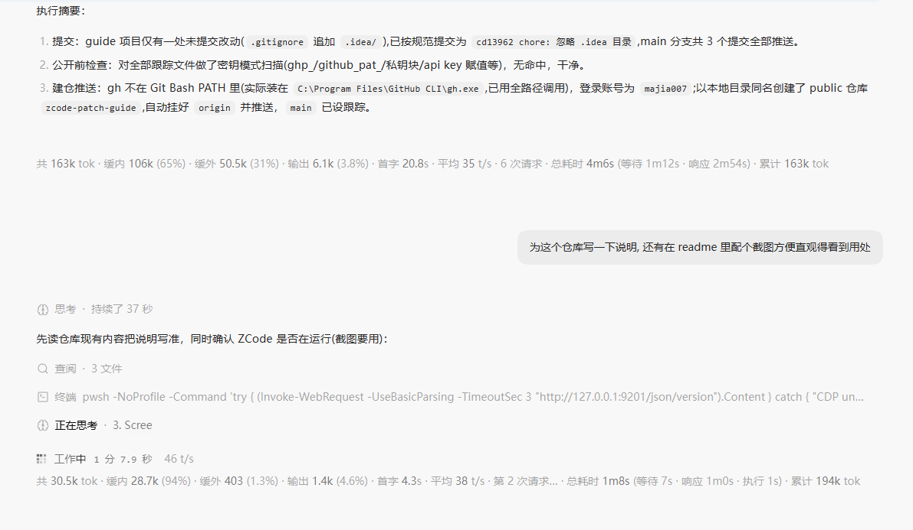

# zcode-patch-guide

## 使用说明

不需要自己动手解包打补丁——把仓库地址丢给 agent,让它照本仓库的说明操作即可。典型指令(可直接复制):

> 按 https://github.com/majia007/zcode-patch-guide 的说明给 ZCode 装补丁:先读仓库说明,把可用功能介绍给我,问我要装哪些,我确认后再部署

- 已经知道自己要什么的话,直接在指令里点名功能即可:`token 统计条(tok-badge)`、`ESC 拦截(block-esc)`、`剩余额度(quota-balance)`、`请求分组标记(request-marker)`、`项目分区增强(project-tools)`,可以多选或都要
- 前提:agent 需要在装了 ZCode 的这台机器上运行,能执行命令、读写文件

不想经 agent 也可以手动执行,见[快速开始](#快速开始手动)。

## 快速开始(手动)

```bash
git clone https://github.com/majia007/zcode-patch-guide && cd zcode-patch-guide
# 1. 解包(<resources> 换成你的 ZCode 安装目录下的 resources,定位见 guide/common/environment.md)
npx --yes @electron/asar extract "<resources>/app.asar" unpack/app_extract
# 2. 打包并挂换装监视器(安装目录不在常见路径时,前置 ZCODE_RES=<resources> 环境变量)
node inject/pack.mjs --deploy
#    只装部分功能: node inject/pack.mjs --scripts tok-badge,block-esc --deploy(未选模块的既有注入块保留)
# 3. 完全退出 ZCode(右键托盘图标退出;点窗口 × 只是隐藏)→ 自动换装并自动重启
```

回滚:把 `<resources>/app.asar.old` 改名回 `app.asar` 重启即可(详见 `guide/common/pipeline.md`)。

功能开关(DevTools 控制台,改后刷新):`localStorage.setItem('zcode:tok-badge:enabled','0')` / `localStorage.setItem('zcode:block-esc:enabled','0')` / `localStorage.setItem('zcode:quota-balance:enabled','0')` / `localStorage.setItem('zcode:request-marker:enabled','0')` / `localStorage.setItem('zcode:project-tools:enabled','0')`。

## 功能

给 ZCode 桌面客户端打本地补丁的**注入工具链 + 操作手册**,目前提供五个功能:

- **tok-badge** — 对话气泡旁的 token 用量/耗时统计
- **block-esc** — 防误触的 ESC 条件拦截
- **quota-balance** — 上下文用量浮层里的第三方剩余额度段(需要本机运行 magpie 聚合器,见 [guide/quota-balance/facts.md](guide/quota-balance/facts.md))
- **request-marker** — 步骤流按模型请求分组标记(组折叠头 `#min → #max` 区间 + 组内段首 `#N` 标签,见 [guide/request-marker/facts.md](guide/request-marker/facts.md))
- **project-tools** — 左侧「项目」分区的名称/更新时间排序、项目名筛选(宽时输入框常驻自适应、窄时按钮展开)、行内「移到最上方」、运行中任务图标与空闲后台任务标记、任务行时间按实际活跃时刻刷新并排序(见 [guide/project-tools/facts.md](guide/project-tools/facts.md))

全部修改经解包→注入→打包→换装落地,自动保留回滚包。



> 实机截图:回复生成中,加载图标旁出现实时速度位(`工作中 1 分 7.9 秒 · 46 t/s`);每条回复下方是统计行(总量 / 缓内·缓外·输出占比 / 首字 / 平均速度 / 请求次数 / 耗时分解 / 会话累计)。**block-esc** 无界面(静默拦截 ESC),没有截图。

> ⚠️ **免责声明**:ZCode 为专有软件。本仓库包含对其安装产物的修改方法、修改物与逆向定位指引,仅供个人本地学习与自用,与 ZCode 官方无关,亦不获其授权;修改客户端可能违反软件使用许可,由此产生的一切风险与后果由使用者自行承担。官方升级会整体替换 app.asar、注入随之丢失属正常现象。不接受以上条款请勿使用。

## 平台支持

| 平台 | 状态 |
|------|------|
| Windows | ✅ 实测(3.14.1 ~ 3.18.1 系列多版本) |
| macOS | ⚠️ experimental,**未实测**——安装路径/进程探测分支已写,但改已签名 app 的 asar 需 ad-hoc 重签,见 `guide/common/environment.md` |

## 给 agent:从这里开始

典型指令长这样:**「按照 https://github.com/majia007/zcode-patch-guide 的说明给 ZCode 装补丁:先介绍功能,问我装哪些」**(即开头「使用说明」里的模板)。你的任务分两步:

1. **先问后装**:读完本 README,向用户逐个介绍功能(一句话效果 + 前提与开关;quota-balance 需本机 magpie 这类前提要点明),请用户选择要装哪些;用户已在指令里点名功能的,跳过询问直接进下一步
2. **完整部署**:探测 → 解包 → 锚点抽查(只查所选功能的锚点卡)→ 注入打包(`node inject/pack.mjs --scripts <所选模块逗号列表> --deploy`,未选模块的既有注入块原样保留;装全量则省略 `--scripts`)→ 换装 → 验证

按下表路由读文件,然后照 `guide/common/pipeline.md` 执行:

| 场景 | 要读 |
|------|------|
| 任何部署(必读) | `guide/common/environment.md` → `guide/common/pipeline.md` |
| token 统计(tok-badge) | + `guide/tok-badge/facts.md`(锚点卡+验证清单) |
| ESC 拦截(block-esc) | + `guide/block-esc/facts.md` |
| 剩余额度(quota-balance) | + `guide/quota-balance/facts.md`(需本机 magpie,地址从 ZCode provider 配置解析,默认 `127.0.0.1:3425`) |
| 请求分组标记(request-marker) | + `guide/request-marker/facts.md` |
| 项目分区增强(project-tools) | + `guide/project-tools/facts.md`(锚点卡+验证清单) |
| 锚点 MISS / 升级后功能失效 / 需要重新定位 | `guide/common/method.md`(渔:锚点怎么选、漂移怎么甄别重定位) |

三条硬红线(详版在 pipeline.md 末尾):

1. **不要替用户退出 ZCode**——你的会话可能就跑在 ZCode 进程里;跑到换装步骤,把「请完全退出 ZCode」这句话交给用户,监视器会自动完成换装+重启
2. 版本变了必须重新解包再打包,不能拿旧 `unpack/` 产物硬打(等于给客户端降级)
3. 对安装目录的修改只经 `inject/` 工具链;结论(锚点是否漂移、功能是否正常)要有 grep/运行输出佐证,拿不准如实说未验证

## 目录

```
├── README.md               # 本文件
├── guide/
│   ├── common/
│   │   ├── environment.md  # 环境探测:找安装目录、asar+unpacked 成对、版本核对、mac 注意
│   │   ├── pipeline.md     # 部署流水线:解包→抽查→打包→换装→验证→回滚(命令级)
│   │   └── method.md       # 渔:minified 阅读法、锚点规范与稳定性判据、MISS 甄别、漂移重定位
│   ├── tok-badge/facts.md  # token 统计:锚点卡 24 条 + 机制最小结论 + 验证清单
│   ├── block-esc/facts.md  # ESC 拦截:锚点卡 + 机制 + 验证清单
│   ├── quota-balance/facts.md  # 剩余额度:锚点卡 + 注入链 + 验证/排障
│   ├── request-marker/facts.md # 请求分组标记:锚点卡 + 机制 + 验证清单
│   └── project-tools/facts.md  # 项目分区增强:锚点卡 + 机制 + 验证清单
├── inject/
│   ├── tok-badge.js        # 徽标脚本(手工维护物;头注释=全量设计文档)
│   ├── block-esc.js        # ESC 拦截脚本
│   ├── quota-balance.js    # 渲染端额度段脚本(挂到上下文容量浮层)
│   ├── quota-main.cjs      # 主进程额度轮询器(拷到 resources 根目录,入口尾部动态 import)
│   ├── request-marker.js   # 请求分组标记脚本(React fiber 读行数据,打 data-zrq-*)
│   ├── project-tools.js    # 项目分区增强脚本(排序/筛选/移到最上方/运行中图标/后台任务标记/任务时间排序,打 data-zqp-*)
│   ├── pack.mjs            # 注入打包器:注入 index.html → 挂主进程模块 → 三重校验 → asar 打包;--scripts 选集注入;--deploy 挂换装监视器
│   └── apply-update.mjs    # 换装监视器:等退出→防降级校验→换装→按原命令行重启
└── tools/
    ├── restart-watcher.ps1 # 重启换装监视器:计划任务脱离调用方 job + wscript 隐藏启动
    └── hidden-run.vbs      # wscript 隐藏启动 node 的 VBS 宿主(restart-watcher.ps1 调用)
```

`unpack/`(解包产物,~700MB)与 `tmp/` 已 gitignore,随时可删可再生。

## 同步口径(维护者)

本仓库从上游客户端分析仓库同步功能时采用**白名单**:只同步下列五项,其它补丁一律不移植。

| 白名单项 | 文件 | 说明 |
|---|---|---|
| token 统计 | `inject/tok-badge.js` | 对话气泡旁的 token 用量/耗时统计 |
| 屏蔽 ESC | `inject/block-esc.js` | 条件式 ESC 拦截 |
| magpie 额度显示 | `inject/quota-balance.js` + `inject/quota-main.cjs` | 上下文容量浮层内的第三方剩余额度段 |
| 请求分组标记 | `inject/request-marker.js` | 步骤流按模型请求分组标记(组折叠头区间 + 组内段首标签) |
| 项目分区增强 | `inject/project-tools.js` | 左侧项目分区的名称/更新时间排序、项目名筛选(双形态)、移到最上方、运行中图标、任务行后台标记、任务时间改写/排序冻结 |

白名单外的补丁**不得进入本仓库**。新增白名单项须明确批准,并同时更新本节、`inject/pack.mjs` 的 `SCRIPTS` 与对应 facts 卡。

`tools/restart-watcher.ps1` + `tools/hidden-run.vbs` 属换装工具链同步(不注入客户端,不占白名单项),用于 `--deploy` 的换装监视器被调用方 job 回收后重启。

## 已实测版本

Windows,3.14.1 / 3.14.3 / 3.14.4 / 3.15.1 / 3.15.3 / 3.16.1 / 3.16.3 / 3.17.1 / 3.17.2 / 3.18.0 / 3.18.1——锚点稳定性先例与升级漂移记录见 `guide/common/method.md`。

quota-balance 在 3.17.1 / 3.17.2 实测(依赖该版本的浮层结构与 magpie 本地接口);request-marker 在 3.17.2 实机上线,3.18.0 适配组级折叠(组头区间标签 + 组内段首标签,页内 CDP 热替换验证)并于 3.18.1 实机运行(组头统计跨组补齐终版),其锚点卡在 3.17.1 / 3.17.2 / 3.18.0 / 3.18.1 解包产物均逐条命中(3.18.0 的 `assistantResponseId` 渲染侧字面量退出,改为 validation/schema 旁路命中);project-tools 随上游 3.17.2 实机验证(排序/筛选/移顶/spinner),其锚点卡在 3.17.1 与 3.17.2 解包产物均逐条命中;2026-11-12 增补任务时间改写/排序冻结与筛选双形态(页内 CDP 热替换验证),锚点卡在 3.17.1 / 3.18.1 解包产物逐条命中;tok-badge / block-esc 的版本覆盖见上。
