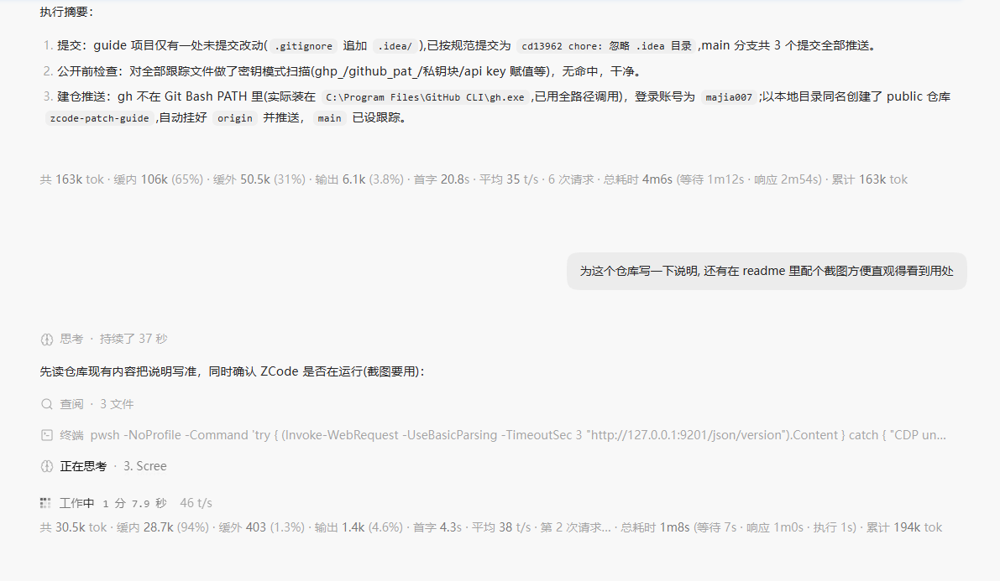

# zcode-patch-guide

给 ZCode 桌面客户端打本地补丁的**注入工具链 + 操作手册**:目前提供两个功能——**tok-badge**(对话气泡旁的 token 用量/耗时统计)与 **block-esc**(防误触的 ESC 条件拦截)。全部修改经解包→注入→打包→换装落地,自动保留回滚包。



> 实机截图:回复生成中,加载图标旁出现实时速度位(`工作中 1 分 7.9 秒 · 46 t/s`);每条回复下方是统计行(总量 / 缓内·缓外·输出占比 / 首字 / 平均速度 / 请求次数 / 耗时分解 / 会话累计)。**block-esc** 无界面(静默拦截 ESC),没有截图。

> ⚠️ **免责声明**:ZCode 为专有软件。本仓库包含对其安装产物的修改方法、修改物与逆向定位指引,仅供个人本地学习与自用,与 ZCode 官方无关,亦不获其授权;修改客户端可能违反软件使用许可,由此产生的一切风险与后果由使用者自行承担。官方升级会整体替换 app.asar、注入随之丢失属正常现象。不接受以上条款请勿使用。

## 平台支持

| 平台 | 状态 |
|------|------|
| Windows | ✅ 实测(3.14.1 ~ 3.17.1 系列多版本) |
| macOS | ⚠️ experimental,**未实测**——安装路径/进程探测分支已写,但改已签名 app 的 asar 需 ad-hoc 重签,见 `guide/common/environment.md` |

## 快速开始(给人)

```bash
git clone <本仓库> && cd zcode-patch-guide
# 1. 解包(<resources> 换成你的 ZCode 安装目录下的 resources,定位见 guide/common/environment.md)
npx --yes @electron/asar extract "<resources>/app.asar" unpack/app_extract
# 2. 打包并挂换装监视器(安装目录不在常见路径时,前置 ZCODE_RES=<resources> 环境变量)
node inject/pack.mjs --deploy
# 3. 完全退出 ZCode(右键托盘图标退出;点窗口 × 只是隐藏)→ 自动换装并自动重启
```

回滚:把 `<resources>/app.asar.old` 改名回 `app.asar` 重启即可(详见 `guide/common/pipeline.md`)。

功能开关(DevTools 控制台,改后刷新):`localStorage.setItem('zcode:tok-badge:enabled','0')` / `localStorage.setItem('zcode:block-esc:enabled','0')`。

## 给 agent:从这里开始

典型指令长这样:**「按照 <本仓库地址> 的说明,加一下 token 统计功能」**。你的任务是把它变成一次完整部署:探测 → 解包 → 锚点抽查 → 注入打包 → 换装 → 验证。按下表路由读文件,然后照 `guide/common/pipeline.md` 执行:

| 场景 | 要读 |
|------|------|
| 任何部署(必读) | `guide/common/environment.md` → `guide/common/pipeline.md` |
| token 统计(tok-badge) | + `guide/tok-badge/facts.md`(锚点卡+验证清单) |
| ESC 拦截(block-esc) | + `guide/block-esc/facts.md` |
| 锚点 MISS / 升级后功能失效 / 需要重新定位 | `guide/common/method.md`(渔:锚点怎么选、漂移怎么甄别重定位) |

三条硬红线(详版在 pipeline.md 末尾):

1. **不要替用户退出 ZCode**——你的会话可能就跑在 ZCode 进程里;跑到换装步骤,把「请完全退出 ZCode」这句话交给用户,监视器会自动完成换装+重启
2. 版本变了必须重新解包再打包,不能拿旧 `unpack/` 产物硬打(等于给客户端降级)
3. 对安装目录的修改只经 `inject/` 工具链;结论(锚点是否漂移、功能是否正常)要有 grep/运行输出佐证,拿不准如实说未验证

## 目录

```
├── README.md               # 本文件
├── guide/
│   ├── common/
│   │   ├── environment.md  # 环境探测:找安装目录、asar+unpacked 成对、版本核对、mac 注意
│   │   ├── pipeline.md     # 部署流水线:解包→抽查→打包→换装→验证→回滚(命令级)
│   │   └── method.md       # 渔:minified 阅读法、锚点规范与稳定性判据、MISS 甄别、漂移重定位
│   ├── tok-badge/facts.md  # token 统计:锚点卡 24 条 + 机制最小结论 + 验证清单
│   └── block-esc/facts.md  # ESC 拦截:锚点卡 + 机制 + 验证清单
└── inject/
    ├── tok-badge.js        # 徽标脚本(手工维护物;头注释=全量设计文档)
    ├── block-esc.js        # ESC 拦截脚本
    ├── pack.mjs            # 注入打包器:注入 index.html → 三重校验 → asar 打包;--deploy 挂换装监视器
    └── apply-update.mjs    # 换装监视器:等退出→防降级校验→换装→按原命令行重启
```

`unpack/`(解包产物,~700MB)与 `tmp/` 已 gitignore,随时可删可再生。

## 已实测版本

Windows,3.14.1 / 3.14.3 / 3.14.4 / 3.15.1 / 3.15.3 / 3.16.1 / 3.16.3 / 3.17.1——锚点稳定性先例与升级漂移记录见 `guide/common/method.md`。
